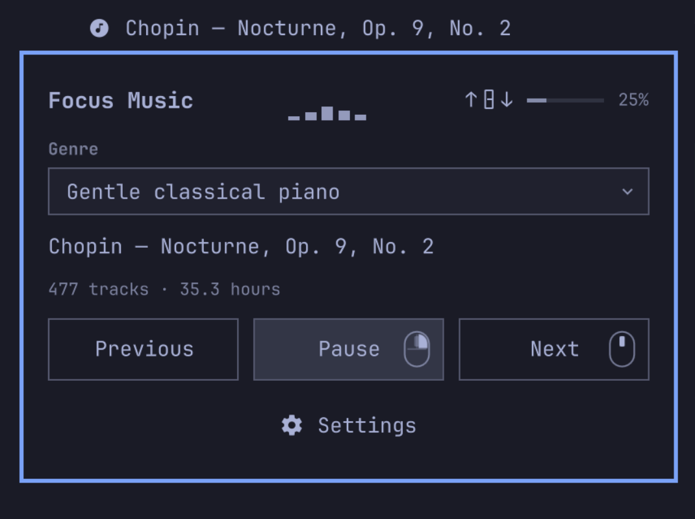
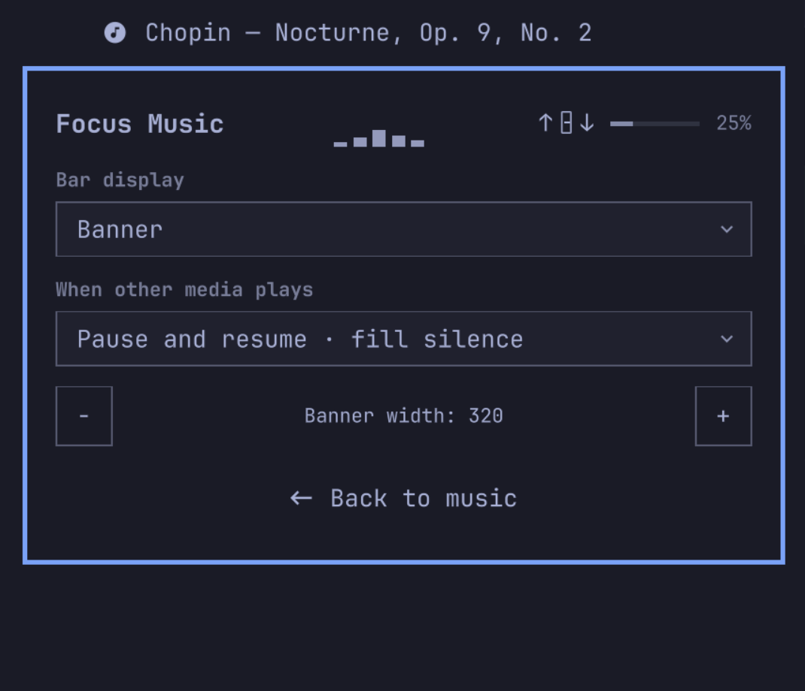

# Focus Music for Omarchy

**Minimal widget for playing instrumental music. No login required!**

Choose a genre and settle into your work. Focus Music streams gentle instrumental playlists or plays your own local music, with controls a hover away.



## Features

- Shuffled instrumental music: lo-fi hip-hop, jazz, classical piano, orchestra, and gentle anime music.
- A scrolling **Banner**, live **Visualizer**, or compact **Note** in your bar.
- A themed popup with a genre selector, Previous / Play / Pause / Next controls, and settings.
- Keyboard media keys and your choice of behavior when other media plays: pause and resume, lower the volume slightly or substantially, or keep playing.
- Background loudness leveling that balances recordings while preserving their musical dynamics.
- Local folders for offline playback. No audio files are bundled or downloaded for you.
- A lightweight Rust backend. No account, subscription, or compiler needed.

## Install

Requires Omarchy 4's Quickshell bar, Linux x86-64 or ARM64, and mpv 0.38+. Streaming uses yt-dlp; local indexing and loudness leveling use FFmpeg.

```bash
omarchy pkg add mpv yt-dlp ffmpeg libnotify
omarchy plugin add https://github.com/Maxrio9/omarchy-focus-music --enable
```

Hover over the widget to open it; left-click pins it open. Hold and drag to move it using Omarchy's bar controls.

| Mouse control | Action |
| --- | --- |
| Right-click | Play / pause |
| Middle-click | Next track |
| Scroll | Adjust music volume |

These controls also work over the open music pane. Volume is remembered and affects only Focus Music.

## Display settings and visualization

Open **Settings** in the popup to choose Banner, Visualizer, or Note; adjust the banner or visualizer width; and choose what happens when other media plays.

The visualizer responds to the music and its volume. When it is already shown in the bar, it is hidden in the popup. Media keys follow the other player while it is playing; manually paused music stays paused.



## Catalog

| Genre | Tracks | Playback |
| --- | ---: | ---: |
| Lo-fi hip-hop | 4,339 | 178.3 hours |
| Lo-fi jazz / jazzhop | 886 | 37.8 hours |
| Calm café jazz | 677 | 30.7 hours |
| Gentle classical piano | 477 | 35.3 hours |
| Gentle orchestra & chamber music | 728 | 55.8 hours |
| Gentle anime piano & orchestra | 514 | 24.1 hours |

Sources include [Lofi Girl](https://www.youtube.com/@LofiGirl), [Chillhop Music](https://www.youtube.com/@ChillhopMusic), [Cafe Music BGM channel](https://www.youtube.com/@cafemusicbgmchannel), and [HALIDONMUSIC](https://www.youtube.com/@HALIDONMUSIC). Anime selections include [PianoDeuss](https://www.youtube.com/@PianoDeuss), [Torby Brand](https://www.youtube.com/@TorbyBrand), [kno](https://www.youtube.com/@knoMusic), and playlists curated by [Celestial Aeon Project](https://www.youtube.com/@CelestialAeonProject). Collection links are in [data/collections.json](data/collections.json).

Choosing a genre starts a random track instead of resuming. Tracks shuffle without repeating until the queue has been traversed; skipped tracks count as played. Online music streams from YouTube and requires an internet connection. Source availability can change.

Duplicate uploads and exact source segments are checked, but this is not audio fingerprinting. Different arrangements of the same composition can appear, and Ghibli pieces also remain in the classical genres.

## Add your own music

### Local folders and offline playback

Obtain your own music files and organize them into genre subfolders:

```text
Focus/
├── Piano/
│   ├── Artist - Track.flac
│   └── Another track.mp3
└── Jazz/
    └── Album/
        └── Track.ogg
```

Point the player at the parent folder:

```bash
~/.config/omarchy/plugins/maxrio9.focus-music/bin/focus-music local "$HOME/Music/Focus"
```

Each immediate subfolder becomes a **Local · Genre** entry beside the online genres. Nested album folders are included. Artist/title tags are preferred, with filenames used as a fallback. MP3, FLAC, M4A, Ogg, Opus, and WAV are supported.

Local tracks work offline with shuffle, playback controls, visualization, and loudness leveling. The plugin does not download music for offline use.

Run the same command again after changing the files. It updates the index without moving your music and reports unreadable files. One parent library is indexed at a time. To remove its entries, stop local playback and delete `${XDG_CONFIG_HOME:-~/.config}/focus-music/local-sources.json`.

### Custom online catalogue

Copy [data/sources.json](data/sources.json) to `${XDG_CONFIG_HOME:-~/.config}/focus-music/sources.json` and edit your copy. It replaces the bundled online catalogue, so copy first to keep the existing genres. Local folders remain separate.

Add a genre or append tracks using this structure:

```json
{
  "my-piano": {
    "label": "My piano collection",
    "catalog_version": "my-piano-v1",
    "duration": 300,
    "tracks": [
      {
        "id": "my-piano-unique-track-id",
        "artist": "Artist",
        "title": "Track title",
        "url": "https://www.youtube.com/watch?v=VIDEO_ID",
        "start": 0,
        "end": 300,
        "duration": 300
      }
    ]
  }
}
```

Use unique track IDs and accurate credits. `start` / `end` select a piece within a longer recording; each track's `duration` must equal `end - start`, and the genre duration must be the sum of its tracks. Avoid duplicate entries and keep the JSON valid.

Change `catalog_version` whenever track membership or order changes, so saved queues cannot point at the wrong track. The genre selector refreshes automatically.

## Update or remove

```bash
omarchy plugin update maxrio9.focus-music
```

Updating from 1.x? See the [migration notes](docs/upgrading.md).

Stop the independent player before removing the plugin:

```bash
~/.config/omarchy/plugins/maxrio9.focus-music/bin/focus-music stop
omarchy plugin remove maxrio9.focus-music
```

## Credits

Plugin code is [MIT licensed](LICENSE). Music belongs to its artists and rights holders; this repository contains metadata and player code, not recordings. Support the artists through the source links.

For technical details, see the [performance measurements](docs/performance.md) and [source build instructions](docs/building.md).
