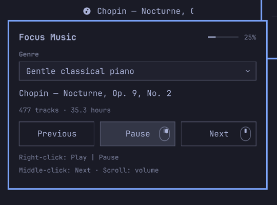

# Focus Music for Omarchy

Instrumental background music, one click from your desktop bar. Pick a genre, see the artist and track name, and control playback with your mouse.



## Features

- Five instrumental genres, each with more than 24 hours of catalogued music.
- Shuffled queues. Choosing a genre starts another unplayed track instead of resuming.
- A fixed-width artist/track banner that scrolls continuously in one direction, pausing at the beginning.
- A themed hover popup with a genre dropdown, equally sized Previous, Play/Pause, and Next buttons with mouse-button hints, an instant volume readout beside the title, and mouse-control guide. Left-click pins it open.
- Background audio through mpv, streamed from YouTube without opening a browser.
- Background track loudness leveling with peak-safe fixed gain, preserving the dynamics inside each piece.
- No audio files bundled or permanently downloaded.

| Gesture on the banner | Action |
| --- | --- |
| Hover | Show the genre and playback popup |
| Left-click | Pin / unpin the popup |
| Right-click | Pause / resume |
| Middle-click | Next track |
| Mouse wheel | Adjust music volume by 5% |

Music starts at 20% player volume and remembers volume changes. It does not change your system volume.

## Install

Requires **Omarchy 4's Quickshell bar** with the `qs.Commons` and `qs.Ui` components (`PopupCard`, `Dropdown`, and the bar buttons), Python 3.8+, **mpv 0.38+**, a recent yt-dlp, and FFmpeg for loudness measurement. Tested on Omarchy 4.0.4 with mpv 0.41. Other Omarchy versions must provide the same shell UI API. A plain Hyprland installation or a Waybar-based Omarchy bar can use the command-line player; the QML widget requires the Omarchy shell. `notify-send` is optional and provides error notifications.

Install any missing dependencies:

```bash
omarchy pkg add python mpv yt-dlp ffmpeg libnotify
```

Then install and enable the plugin:

```bash
omarchy plugin add https://github.com/Maxrio9/omarchy-focus-music --enable
```

Place it immediately before the clock:

```bash
omarchy bar move maxrio9.focus-music --section center --before omarchy.clock
```

If your shell retains an older widget after an update, run `omarchy restart shell`. Playback runs separately from the shell.

## Catalog

| Genre | Tracks | Catalogued playback |
| --- | ---: | ---: |
| Lo-fi hip-hop | 4,339 | 178.3 hours |
| Lo-fi jazz / jazzhop | 886 | 37.8 hours |
| Calm café jazz | 677 | 30.7 hours |
| Gentle classical piano | 477 | 35.3 hours |
| Gentle orchestra & chamber music | 728 | 55.8 hours |

Sources include **Lofi Girl**, **Chillhop Music**, **Cafe Music BGM channel**, and **HALIDONMUSIC**. Original collection URLs are in [data/collections.json](data/collections.json). For classical music, the banner credits the composer where performer information is unavailable.

The catalog contains URLs, credits, durations and start/end boundaries. Those boundaries turn long mixes into individual skippable tracks. Playback streams audio into mpv's memory buffer; a working internet connection is required.

Duplicate metadata IDs and identical URL/start/end segments are removed across all five genres. This is a metadata audit, not audio fingerprinting: differently named uploads or different performances of the same composition may overlap. Catalogued hours describe the source listings; unavailable or removed videos can reduce playable hours. Queues repeat after all queued entries have been traversed, and skipped tracks count as traversed.

## Loudness leveling

The player measures each complete track in the background using FFmpeg's [EBU R128 scanner](https://ffmpeg.org/ffmpeg-filters.html#ebur128). It aims for −23 LUFS and calculates one gain adjustment for the whole piece, limited by a −2 dB true-peak ceiling and a maximum 12 dB boost. It does not compress the recording or continuously boost quiet passages. Quiet introductions and climaxes retain their contrast. A recording with unusually large dynamics may stay below the average target because peak headroom takes priority.

On the first listen, measurement streams the track once more for analysis. Music keeps playing while it runs; the measured gain is introduced with a three-second transition and then held steady. The next two queued tracks are checked ahead of playback. Only numeric loudness/peak measurements are cached under `${XDG_CACHE_HOME:-~/.cache}/focus-music/loudness/`, not audio or signed streaming URLs. This uses additional bandwidth when a track has not been measured before. If analysis fails, playback continues at its normal level.

To disable measurement for a new player instance, set `FOCUS_MUSIC_NORMALIZE=0` before launching it. The visible volume percentage is your player-volume setting, separate from the per-track gain. Stop the independent player from the command line before starting a new instance if you need to change its environment.

## Customize

Set the banner width in Omarchy's logical size units:

```bash
omarchy bar set maxrio9.focus-music bannerWidth 180 --json
```

The default is 180, with a supported range of 80–500. The fixed width keeps neighboring widgets steady when the track changes. The preview above is captured from this same popup using a sample track; colors and corner shapes follow your Omarchy theme.

The plugin uses its bundled catalog by default. Put a custom catalog at `${XDG_CONFIG_HOME:-~/.config}/focus-music/sources.json` to override it. Each genre has a `label`, `catalog_version`, total `duration`, and a `tracks` array; each track supplies a unique `id`, `artist`, `title`, `url`, `start`, `end`, and `duration`. Change `catalog_version` whenever you change the track ordering or membership.

State is saved under `${XDG_STATE_HOME:-~/.local/state}/focus-music/`. The private mpv socket and playback log live under `$XDG_RUNTIME_DIR/focus-music/`.

The player also works from the command line on Linux desktops:

```bash
~/.config/omarchy/plugins/maxrio9.focus-music/bin/focus-music genres
~/.config/omarchy/plugins/maxrio9.focus-music/bin/focus-music play piano
~/.config/omarchy/plugins/maxrio9.focus-music/bin/focus-music toggle
~/.config/omarchy/plugins/maxrio9.focus-music/bin/focus-music previous
~/.config/omarchy/plugins/maxrio9.focus-music/bin/focus-music skip
~/.config/omarchy/plugins/maxrio9.focus-music/bin/focus-music stop
```

For testing or separate player instances, override `FOCUS_MUSIC_CONFIG`, `FOCUS_MUSIC_STATE`, `FOCUS_MUSIC_RUNTIME`, and `FOCUS_MUSIC_CACHE`.

## Update or remove

```bash
omarchy plugin update maxrio9.focus-music
```

Before removing the plugin, stop its independent audio player:

```bash
~/.config/omarchy/plugins/maxrio9.focus-music/bin/focus-music stop
omarchy plugin remove maxrio9.focus-music
```

Saved volume and queue state remain in your user state directory.

## Development

The controller uses only Python's standard library. Offline tests check catalog durations and duplicate entries, shuffle consumption, segment boundaries, portable paths, clean installs with spaces and Unicode, unset/empty/custom XDG directories, track credits, mpv's JSON IPC framing, and track-wide normalization. Waveform tests verify that differently mastered levels converge while quiet/loud contrast stays intact.

```bash
python -m unittest discover -s tests -v
python scripts/audit-catalog.py
omarchy plugin validate .
```

For a playback smoke test, point `FOCUS_MUSIC_RUNTIME` and `FOCUS_MUSIC_STATE` at temporary paths and set the player volume to zero before playing. QML uses Omarchy's `qs.Commons` and `qs.Ui` modules, so test it in the Omarchy shell.

## License and music credits

Plugin code is [MIT licensed](LICENSE). The music belongs to its respective artists and rights holders. This repository distributes source metadata and player code, not audio recordings. Support the artists and channels through the source links.
